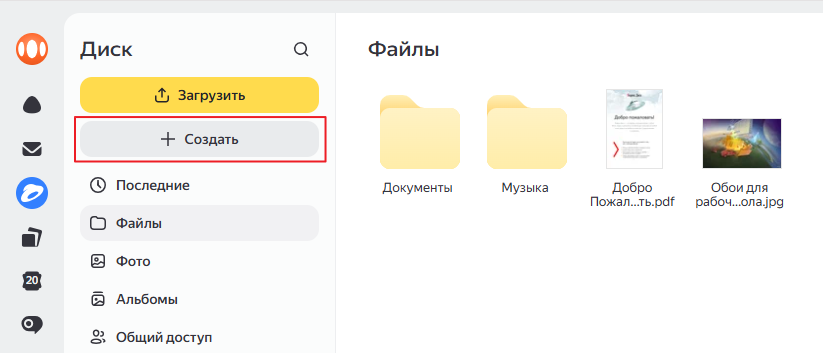
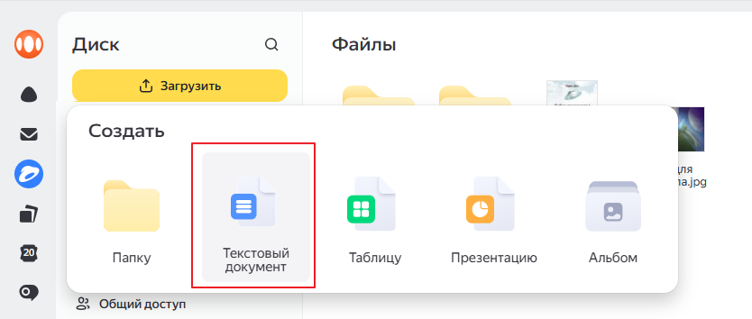
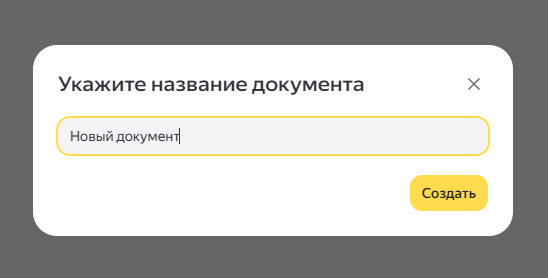
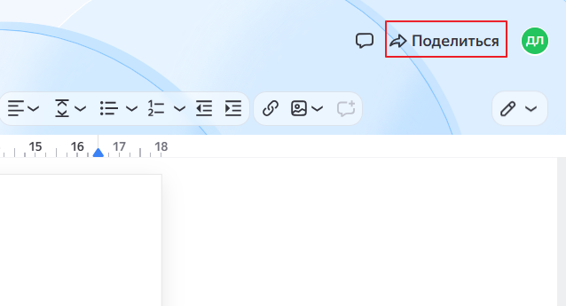
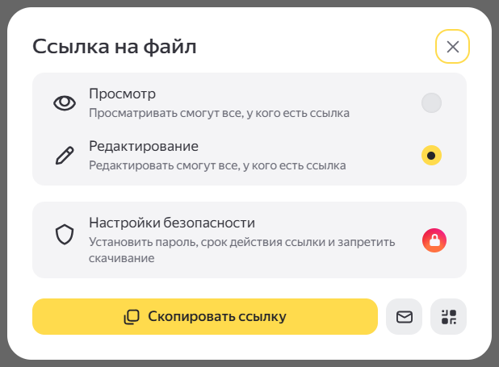

# Как создать документ и настроить совместный доступ в Яндекс Диске

Инструкция описывает, как создать новый текстовый документ в веб-версии Яндекс Диска и открыть к нему доступ другим пользователям.

## Предварительные условия

* Вы авторизованы в аккаунте Яндекс.
* В браузере открыта главная страница Яндекс Диска (`disk.yandex.ru`).

## Пошаговая инструкция

1. В левом верхнем углу экрана нажмите кнопку **Создать**.

   

2. В выпадающем меню выберите пункт **Текстовый документ**.

   

3. В открывшемся окне **Укажите название документа** введите название файла.

   

4. Нажмите кнопку **Создать**.

5. В правом верхнем углу открывшегося редактора нажмите кнопку **Поделиться**.

   

6. В окне **Ссылка на файл** выберите уровень прав для участников (**Просмотр** или **Редактирование**).

   

7. В нижней части окна нажмите кнопку **Скопировать ссылку**.